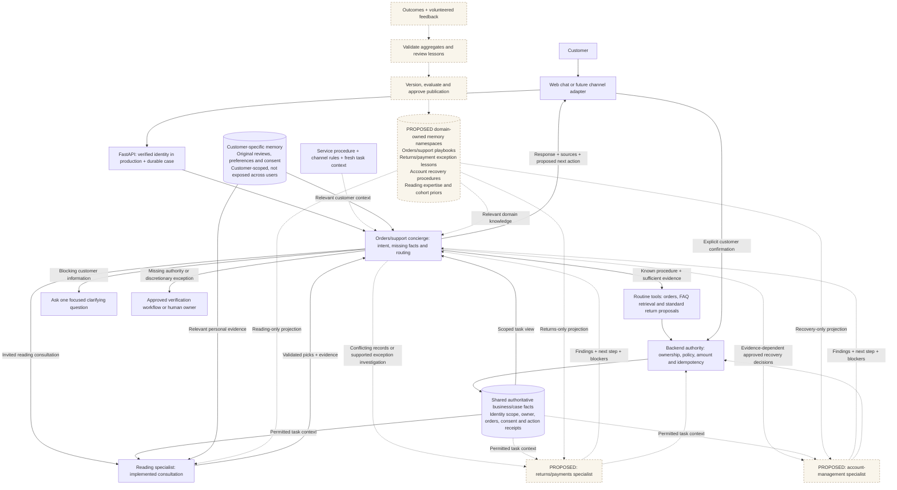

# Bookly Concierge

A local bookstore support demo with order assistance, returns, and personalized book
recommendations. Two Pydantic AI agents share customer context through a FastAPI app
and PostgreSQL database.

## Get started

Install and start **Docker Desktop** (or Docker Engine with Compose v2). Open a
terminal in this repository and run:

```sh
docker compose up --build -d --wait
```

Open **http://127.0.0.1:8010**. A fresh installation defaults to **scripted mode** and
needs no API key. Mode is automatic: an empty `LLM_PROVIDER` selects scripted replies;
a configured provider selects live replies and requires a model and API key. The red
**Scripted · enable live** indicator opens setup instructions. For details, follow [New user setup](docs/setup-and-demo.md#new-user-setup-direct-api-key).
Scripted mode supports the scenario prompts below; arbitrary follow-ups require live mode.

Stop with `docker compose stop`; restart with `docker compose up -d --wait`.
Saved conversations and demo records persist between runs.

Keep this demo local: the customer picker simulates sign-in. Books, purchases,
returns, and dataWarehouse activity are fictional; no real refund or message is sent.

## Try the scenarios

Start as **Maya Chen**. Topic suggestions fill an editable draft; press **Enter** or
select Send to submit it. Confirmation cards always require a separate click.

### Find an order

Send **“Where is my order?”**, then **“The Last Lighthouse.”** The agent clarifies
which purchase you mean and gives its recorded arrival estimate.

### Return a book and find a better fit

1. Send **“Return The Midnight Archive. The book wasn't for me.”** The agent checks
   eligibility and prepares a return card. Answering the optional feedback question
   is not required to proceed.
2. Reply **“It was too dark for me.”** Reload to see that the conversation and pending
   card persist, then click **Confirm return**. This records a mock return request.
3. Send **“Recommend a light mystery under $22.”** The generalist delegates to the
   reading specialist, using the feedback to find a better fit.

### Ask a general support question

Choose **General questions**, then ask **“How much does shipping cost?”**, **“How do
I reset my password?”**, or **“What is your return policy?”** The agent retrieves mock
help-center passages before answering. Open a **help article** reference to inspect
the source and version. Ask **“Do you offer gift wrapping?”** to see the no-match fallback.
Password guidance is informational; this demo cannot send reset emails or change credentials.

### Find my next read

1. Select **Start a fresh conversation**, then send **“Can you help me find my next
   read?”** Maya already has saved preferences, a prior review, and mock wishlist,
   browsing, and dismissal activity; she does not need to repeat her tastes.
2. Hover, focus, or tap a **review** or **activity** reference to inspect its dated
   source. Wishlist and browsing signals favor relevant books; dismissed suggestions
   are excluded.
3. Send **“Recommend a light mystery under $22”**, then **“Recommend a dark mystery
   under $22.”** Current requests override older tastes, and budget and purchase
   exclusions still apply across the 24-book catalog.
4. Ask **“Which of those would you pick for me, and why?”**, then say **“Remember I
   like lighter mysteries.”** Click **Save preference** to share that preference
   across future conversations.

Open **Past conversations** to resume a saved case. In **Demo lab**, inspect tool
activity and shared state, or switch to **Theo Brooks** for a separate customer profile
and hopeful science-fiction recommendations.

To replay from the baseline, click **Reset demo data** and confirm. This clears both
customers' demo history and restores fixtures with fresh dates; LLM settings stay
unchanged. Starting a fresh conversation alone does not undo returns or saved preferences.

## Architecture and database decisions

The thesis is to resolve issues with little customer effort and use relevant proactive
engagement to improve the next experience and increase loyalty. The demo shows optional
in-conversation help grounded in known context; outbound outreach is future work and
loyalty improvement has not been measured.

### Implemented demo and proposed target

The running app has **two Pydantic AI agents** in `web-1`: a generalist concierge and
a reading specialist. `postgres-1` stores operational records and customer/case context.
Both agents use the same configured provider through separate runs. Pydantic AI handles
the model/tool loop; Python code defines tools, delegation, persistence and guardrails.

The concierge currently handles orders, general support retrieval and return proposals.
The reading specialist handles invited discovery with a narrow tool set and structured
output. Password help is informational; account mutations and payment settlement are
not implemented. Business integrations and customer identity are mocked.

**The hybrid architecture below is the proposed production evolution.** It adds domain
specialists for supported exception investigation and evidence-dependent recovery,
plus reviewed domain learning. Those additional agents and memory-learning capabilities
are not present in the current demo. The [implemented diagram](docs/bookly-current-architecture.mmd)
and [target Mermaid source](docs/bookly-architecture.mmd) keep that distinction explicit.

### Hybrid routing and specialist triggers

Hybrid means one orders/support concierge handles routine support through tools,
while domain specialists handle focused reasoning. Within that architecture,
returns follow fixed stages and the reading specialist selects and explains books.

The concierge remains the customer-facing owner and handles routine requests through
known tools or approved retrieval. Specialists return typed findings, evidence,
proposed next steps and blockers. A full conversation/human handoff is a separate,
explicit change of case ownership.



| Request or condition | Route | Boundary |
| --- | --- | --- |
| Known order, general help question, or standard return | Concierge tools/retrieval | Supported procedure, sufficient evidence and allowed action |
| Invited next-read consultation | Reading specialist | Task fit; this need not be a difficult request |
| Conflicting return/payment/fulfillment records or a supported exception | Proposed returns/payments specialist | Domain interpretation or evidence gathering; no policy override |
| Evidence-dependent steps within approved account recovery | Proposed account specialist | Verified recovery workflow and permitted actions must exist first |
| Missing customer fact | One focused clarifying question | Another agent cannot manufacture the missing evidence |
| Missing authorization, an unsupported action or discretionary policy exception | Approved verification or a human | Delegation cannot grant authority |

Routing uses explicit capability/evidence criteria, not only an LLM confidence score.
Basic returns are consequential actions, even on the routine path. The customer
confirms, and backend code rechecks ownership, eligibility, paid amount and duplicates.
Domain specialists do not require separate containers; deployment is a separate decision.

### Shared, customer-specific and unique domain memory

These are logical ownership and access boundaries, not necessarily separate databases.
The same business fact should have one authoritative owner rather than conflicting
copies in each agent's memory.

| Memory layer | Contents | Ownership and access |
| --- | --- | --- |
| Shared business/case state | Verified identity scope, current goal, owner, order facts, blockers, action receipts | Authoritative backend records; customer/object scope and RBAC still apply |
| Customer-specific memory | Explicit preferences, original reviews, consent and relevant history | Scoped to that customer; never a pool of private conversations exposed to other users |
| Unique domain/specialist memory | Curated expertise, domain procedures, reviewed lessons and validated cohort/ranking signals | Domain-owned, versioned and retrieved through a minimal task-specific projection |
| Temporary working context | Current candidates, evidence and the active consultation state | Bounded to the task; not automatically promoted into lasting knowledge |

Shared memory preserves continuity across agents, channels and pauses. Unique memory
provides deeper domain expertise. An agent can receive a view of shared/customer facts
and retrieve its own domain knowledge without obtaining unrestricted access to either.

| Domain | Why it exists | Current-case context | Unique domain knowledge in the target design |
| --- | --- | --- | --- |
| Orders/support concierge | Routine service and delivery guidance, normally concierge-led | Owned order, delivery record, region and current question | Carrier/support playbooks and reviewed delay patterns |
| Returns/payments | Supported exception investigation | Paid amount, policy version, eligibility, proposal, consent, receipt and settlement references | Approved exception procedures and reviewed resolution lessons |
| Account management | Approved verified recovery | Verified identity, recovery stage, allowed actions and blockers | Recovery procedures and reviewed failure patterns; no passwords/codes |
| Reading/discovery | Personalized guidance | Current wishes, personal feedback, budget and eligible catalog | Book expertise, validated ranking lessons and aggregate cohort priors |

A domain can own procedures and memory without adding an LLM agent for every routine
operation. A specialist is justified when its reasoning task, context, permissions
and evaluation requirements warrant another model loop.

### Tradeoffs and learning expansion

| Choice | Tradeoff | Benefit |
| --- | --- | --- |
| Routine tool path plus specialists | Routing errors, extra model latency and handoff coordination | Keep common support fast while using domain expertise where needed |
| Shared authoritative facts plus unique domain knowledge | Ownership, retrieval, freshness and controlled memory writes | Preserve continuity without confusing individual facts and group inferences |
| Fixed return workflow: identify copy → check eligibility → show card → confirm | Unsupported recovery paths need a new flow or human; less flexible than agent-selected tool sequences | Known demo scenarios need few decisions, so explicit stages are easier to verify |

The three production priorities are:

1. **More flexible specialist workflows:** allow evidence selection and tool sequencing
   as cases become more complex, while retaining permissions, transaction limits and consent.
2. **Connected service with human ownership:** integrate backend systems with enforced
   RBAC; preserve context across channels and human handoffs, with pause/resume and
   consent-based proactive outreach.
3. **Specialist memory that improves with outcomes:** evaluate and version reviewed
   domain lessons, preserve authoritative customer facts, monitor changes and support rollback.

The proposed learning cycle is **outcomes/feedback → validated aggregation or reviewed
lessons → versioning and evaluation → approved publication → scoped retrieval**, with
monitoring and rollback. Record source, time window, supporting sample and allowed use.
Do not automatically convert a model's reasoning or one conversation into a general rule.

Reading cohorts could combine stated genre interests, relevant geography and verified
loyalty membership. They are soft priors, not individual preferences. Current requests,
budgets, stock, original customer feedback and backend policy take precedence. Geography
can inform availability and local context; membership benefits need verified entitlement.
The current mock adapter has individual activity, not learned cohort memory.

### Current implementation boundaries

PostgreSQL fits customer/order/item/proposal/receipt relationships. Foreign keys,
transactions, row locks and unique constraints protect operational integrity and duplicate
requests. Prices use integer cents. Flexible context and history use JSON alongside
relational records. Confirmation receipts are replayed into agent history and current
status is read from the database; older pending text cannot become action authority.

General support uses bounded keyword retrieval over three versioned local help articles
in [bookly/knowledge.py](bookly/knowledge.py). The reading specialist searches a 24-book
catalog and consumes the [mock dataWarehouse adapter](bookly/warehouse.py), whose wishlist,
browsing and dismissal signals affect eligible candidates. Source previews distinguish
reviews, customer messages, help text and observed activity. Explicit preferences still
require Save preference; current-case feedback stays distinct from permanent tastes.

No vector database or external warehouse is required. `create_all` bootstraps this local
demo; production needs migrations, verified authentication, real integrations and enforced
connector permissions. Real human ownership, SMS/voice, outbound outreach, additional
domain specialists and learned specialist memory remain proposals.

See [current implementation notes](docs/architecture.md), the [full production proposal](docs/production-agent-orchestration.md),
and the active [service procedure](bookly/procedures/service.md). This independent prototype
is informed by natural-language workflow principles; it does not implement Decagon's
proprietary runtime.

## Optional reference

See [Setup and demo reference](docs/setup-and-demo.md) for ports, logs, local Python
development, live-model and gateway configuration, the detailed walkthrough, and
SMS/voice design previews.
